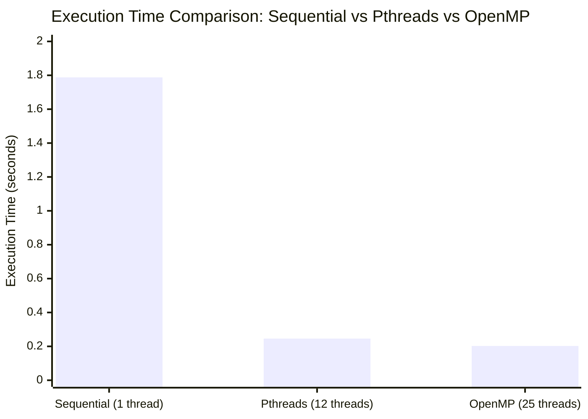

# Multithreading using Pthreads and OpenMP in C

## Experiment 2 — Parallel and Grid Computing

This experiment investigates multithreaded programming in C on a Linux environment (Ubuntu on WSL). It systematically implements, analyzes, and compares concurrent execution models using:

1. **Sequential Baseline CPU Execution**
2. **POSIX Threads (Pthreads)** — Explicit, low-level shared-memory multithreading
3. **OpenMP (Open Multi-Processing)** — High-level, compiler-directive-based shared-memory parallelism

The objective is to explore thread lifecycle management, workload decomposition, race conditions, synchronization primitives (mutex locks, critical sections, barriers), nondeterministic thread scheduling, and execution speedup over sequential computation. Additionally, this study compares shared-memory multithreading against distributed-memory (MPI) and GPU-accelerated (CUDA) paradigms.

---

## Table of Contents

- [1. Objective](#1-objective)
- [2. Problem Definition & Mathematical Formulation](#2-problem-definition--mathematical-formulation)
- [3. Experimental Environment](#3-experimental-environment)
- [4. Project Structure](#4-project-structure)
- [5. Sequential Baseline Implementation](#5-sequential-baseline-implementation)
- [6. Pthreads Implementations & Experiments](#6-pthreads-implementations--experiments)
  - [6.1 Basic Thread Creation & Termination (`thread1.c`)](#61-basic-thread-creation--termination-thread1c)
  - [6.2 Multi-Thread Argument Passing & Join (`thread2.c`)](#62-multi-thread-argument-passing--join-thread2c)
  - [6.3 Parallel Array Summation (`thread_sum.c`)](#63-parallel-array-summation-thread_sumc)
  - [6.4 Race Condition Demonstration (`race.c`)](#64-race-condition-demonstration-racec)
  - [6.5 Synchronization using Mutex Locks (`mutex.c`)](#65-synchronization-using-mutex-locks-mutexc)
  - [6.6 Performance Benchmark (`pthread_perf.c`)](#66-performance-benchmark-pthread_perfc)
- [7. OpenMP Implementations & Experiments](#7-openmp-implementations--experiments)
  - [7.1 Basic Parallel Region (`omp1.c`)](#71-basic-parallel-region-omp1c)
  - [7.2 Parallel Work-Sharing Loop (`omp_sum.c`)](#72-parallel-work-sharing-loop-omp_sumc)
  - [7.3 Race Condition Demonstration (`omp_race.c`)](#73-race-condition-demonstration-omp_racec)
  - [7.4 Synchronization using Critical Sections (`omp_critical.c`)](#74-synchronization-using-critical-sections-omp_criticalc)
  - [7.5 Barrier Synchronization (`omp_barrier.c`)](#75-barrier-synchronization-omp_barrierc)
  - [7.6 Performance Benchmark (`omp_perf.c`)](#76-performance-benchmark-omp_perfc)
- [8. Race Condition & Synchronization In-Depth Analysis](#8-race-condition--synchronization-in-depth-analysis)
- [9. Actual Experimental Results](#9-actual-experimental-results)
- [10. Performance Comparison & Speedup Analysis](#10-performance-comparison--speedup-analysis)
- [11. Architectural Paradigm Comparison (Pthreads vs OpenMP vs MPI vs CUDA)](#11-architectural-paradigm-comparison-pthreads-vs-openmp-vs-mpi-vs-cuda)
- [12. Verification Summary](#12-verification-summary)
- [13. Compilation and Execution Guide](#13-compilation-and-execution-guide)
- [14. Key Observations](#14-key-observations)
- [15. Conclusion](#15-conclusion)
- [Technologies Used](#technologies-used)
- [Experiment Summary](#experiment-summary)
- [Author](#author)

---

## 1. Objective

The primary objectives of this experiment are:

- To master POSIX Threads (`pthread`) API for explicit thread creation, execution, synchronization, and termination in C.
- To implement compiler-directed parallelism using OpenMP pragmas (`#pragma omp parallel`, `for`, `critical`, `barrier`).
- To demonstrate and verify the occurrence of **race conditions** on shared mutable state caused by unsynchronized concurrent access.
- To enforce thread synchronization using **mutex locks** (`pthread_mutex_t`) in Pthreads and **critical directives** (`#pragma omp critical`) in OpenMP.
- To demonstrate phased barrier synchronization (`#pragma omp barrier`).
- To measure execution time across sequential and multithreaded implementations, quantifying speedup and parallel efficiency.
- To evaluate how shared-memory multithreading (Pthreads and OpenMP) contrasts with distributed-memory (MPI) and massively parallel accelerator (CUDA) computing architectures.

---

## 2. Problem Definition & Mathematical Formulation

### 2.1 Benchmark Computation (Performance Workload)
To evaluate compute throughput, a large numerical summation problem is executed across single-threaded and multithreaded pipelines:

$$S = \sum_{i=1}^{N} i$$

For $N = 1,000,000$:

$$\text{Result} = \frac{N \times (N - 1)}{2} = \frac{10^6 \times 999999}{2} = 499,999,999,500.00$$

All implementations verify correctness against the mathematical invariant:
$$\text{Expected Result} = 499999999500.00$$

### 2.2 Shared Counter Synchronization Benchmark
To empirically expose race conditions, 4 concurrent threads execute a loop incrementing a shared global counter $C$:

$$\Delta C = 1, \quad \text{Iterations per thread} = 100,000, \quad T = 4 \text{ threads}$$

$$\text{Expected Final Counter} = T \times 100,000 = 4 \times 100,000 = 400,000$$

- **Unsynchronized Execution**: Non-atomic read-modify-write operations ($C \leftarrow C + 1$) lead to race conditions, causing thread updates to overwrite one another:
  $$C_{\text{actual}} < 400,000$$
- **Synchronized Execution**: Mutual exclusion enforces serialized access to the critical section:
  $$C_{\text{actual}} = 400,000$$

---

## 3. Experimental Environment

### Hardware
- **Host Processor**: Multi-core x86_64 CPU (12+ logical cores)
- **Host Architecture**: 64-bit Symmetric Multiprocessing (SMP)
- **Memory**: Shared host RAM accessible to all local threads

### Software
- **Operating System**: Ubuntu 22.04 LTS via Windows Subsystem for Linux (WSL 2)
- **Compiler**: GCC (GNU Compiler Collection) 11.4.0
- **Libraries**:
  - `libpthread` (POSIX Threads Library)
  - `libgomp` (GNU OpenMP Runtime Library)
- **Build Flags**: `-pthread` for Pthreads, `-fopenmp` for OpenMP, `-O2` optimization

---

## 4. Project Structure

```text
Multithreading-Pthreads-OpenMP/
│
├── README.md
│
├── pthreads/
│   ├── thread1.c          # Basic thread creation and termination
│   ├── thread2.c          # Multi-thread argument passing and joining
│   ├── thread_sum.c       # Parallel chunked array summation
│   ├── race.c             # Shared counter race condition demonstration
│   ├── mutex.c            # Mutual exclusion lock synchronization
│   └── pthread_perf.c     # 12-thread scalability benchmark
│
├── openmp/
│   ├── omp1.c             # Fork-join model with thread ID query
│   ├── omp_sum.c          # Work-sharing loop construct (#pragma omp parallel for)
│   ├── omp_race.c         # Unsynchronized OpenMP race condition
│   ├── omp_critical.c     # Mutual exclusion (#pragma omp critical)
│   ├── omp_barrier.c      # Phased execution barrier (#pragma omp barrier)
│   └── omp_perf.c         # 25-thread scalability benchmark
│
├── results/
│   └── comparison.md      # Tabulated analysis and benchmark notes
│
├── screenshots/           # Actual terminal execution captures
│   ├── thread1_output.jpeg
│   ├── thread2_output.jpeg
│   ├── thread_sum_output.jpeg
│   ├── race_output.jpeg
│   ├── mutex_output.jpeg
│   ├── omp1_output.jpeg
│   ├── omp_sum_output.jpeg
│   ├── omp_race_output.jpeg
│   ├── omp_critical_output.jpeg
│   ├── omp_barrier_output.jpeg
│   ├── sequential_output.jpeg
│   ├── pthread_perf_output.jpeg
│   └── omp_perf_output.jpeg
│
└── docs/
```

---

## 5. Sequential Baseline Implementation

### 5.1 Description
The sequential program executes on a single CPU execution context without thread creation or parallel runtime overhead. It computes the summation over $10^6$ elements in a single continuous loop, establishing the baseline benchmark time ($T_{\text{seq}}$).

### 5.2 Compilation & Execution
```bash
gcc sequential.c -o seq_exe
./seq_exe
```

### 5.3 Actual Terminal Output
```text
Result = 499999999500.00
Execution time = 1.787701 seconds
```


---

## 6. Pthreads Implementations & Experiments

### 6.1 Basic Thread Creation & Termination (`thread1.c`)
- **Concept**: Demonstrates basic lifecycle management using `pthread_create()` to spawn a worker thread and `pthread_join()` to ensure the main thread waits for worker completion before exiting.
- **Compilation & Execution**:
  ```bash
  gcc thread1.c -o thread1 -pthread
  ./thread1
  ```
- **Terminal Output**:
  ```text
  Hello from the thread!
  Main thread finished.
  ```


---

### 6.2 Multi-Thread Argument Passing & Join (`thread2.c`)
- **Concept**: Spawns multiple threads (Thread 1 to Thread 4) in a loop, passing unique integer identifiers to each thread routine via pointer casting, and subsequently joins each thread.
- **Compilation & Execution**:
  ```bash
  gcc thread2.c -o thread2 -pthread
  ./thread2
  ```
- **Terminal Output**:
  ```text
  Hello from Thread 1
  Hello from Thread 2
  Hello from Thread 3
  Hello from Thread 4
  All threads have finished.
  ```


---

### 6.3 Parallel Array Summation (`thread_sum.c`)
- **Concept**: Partitions an array into 4 independent contiguous chunks. Each thread calculates its local sub-sum independently without lock contention, after which the main thread aggregates the sub-sums.
- **Compilation & Execution**:
  ```bash
  gcc thread_sum.c -o thread_sum -pthread
  ./thread_sum
  ```
- **Terminal Output**:
  ```text
  Thread 1 calculated sum = 30
  Thread 2 calculated sum = 70
  Thread 3 calculated sum = 110
  Thread 4 calculated sum = 150
  Total sum = 360
  ```


---

### 6.4 Race Condition Demonstration (`race.c`)
- **Concept**: Demonstrates an unsynchronized critical section. 4 concurrent threads iterate $100,000$ times, each executing `counter++`. Because the read-modify-write operation is non-atomic, threads overwrite each other's increments.
- **Compilation & Execution**:
  ```bash
  gcc race.c -o race -pthread
  ./race
  ```
- **Terminal Output**:
  ```text
  Expected counter = 400000
  Actual counter   = 141792
  ```
- **Observation**: Over $64.5\%$ of updates were lost due to concurrent write collisions.


---

### 6.5 Synchronization using Mutex Locks (`mutex.c`)
- **Concept**: Enforces mutual exclusion using POSIX mutex (`pthread_mutex_t`). The critical section is guarded using `pthread_mutex_lock()` and released via `pthread_mutex_unlock()`.
- **Compilation & Execution**:
  ```bash
  gcc mutex.c -o mutex -pthread
  ./mutex
  ```
- **Terminal Output**:
  ```text
  Expected counter = 400000
  Actual counter   = 400000
  ```
- **Observation**: Data integrity is completely preserved; zero updates are lost.


---

### 6.6 Performance Benchmark (`pthread_perf.c`)
- **Concept**: Executes the heavy numerical summation problem ($N = 10^6$) across 12 worker threads.
- **Configuration**: `12 threads`
- **Compilation & Execution**:
  ```bash
  gcc pthread_perf.c -o pthread_perf -pthread
  ./pthread_perf
  ```
- **Terminal Output**:
  ```text
  Enter number of threads: 12
  Result = 499999999500.00
  Execution time = 0.245800 seconds
  ```


---

## 7. OpenMP Implementations & Experiments

### 7.1 Basic Parallel Region (`omp1.c`)
- **Concept**: Utilizes `#pragma omp parallel` to fork a team of threads. Each thread queries its runtime rank via `omp_get_thread_num()` and the team size via `omp_get_num_threads()`.
- **Compilation & Execution**:
  ```bash
  gcc omp1.c -o omp1 -fopenmp
  ./omp1
  ```
- **Terminal Output**:
  ```text
  Hello from Thread 9 of 16
  Hello from Thread 14 of 16
  Hello from Thread 4 of 16
  Hello from Thread 10 of 16
  Hello from Thread 8 of 16
  Hello from Thread 3 of 16
  Hello from Thread 0 of 16
  Hello from Thread 15 of 16
  Hello from Thread 5 of 16
  Hello from Thread 7 of 16
  Hello from Thread 13 of 16
  Hello from Thread 6 of 16
  Hello from Thread 1 of 16
  Hello from Thread 11 of 16
  Hello from Thread 2 of 16
  Hello from Thread 12 of 16
  ```
- **Observation**: Thread execution ordering is completely **nondeterministic**. Threads execute as scheduled by the operating system kernel and OpenMP runtime.


---

### 7.2 Parallel Work-Sharing Loop (`omp_sum.c`)
- **Concept**: Demonstrates `#pragma omp parallel for`. The OpenMP runtime decomposes the loop iteration space across threads using static scheduling.
- **Compilation & Execution**:
  ```bash
  gcc omp_sum.c -o omp_sum -fopenmp
  ./omp_sum
  ```
- **Terminal Output**:
  ```text
  Thread 6 processing array[6] = 70
  Thread 0 processing array[0] = 10
  Thread 4 processing array[4] = 50
  Thread 5 processing array[5] = 60
  Thread 7 processing array[7] = 80
  Thread 3 processing array[3] = 40
  Thread 1 processing array[1] = 20
  Thread 2 processing array[2] = 30
  Total sum = 360
  ```


---

### 7.3 Race Condition Demonstration (`omp_race.c`)
- **Concept**: Executes 4 concurrent OpenMP threads each performing $100,000$ unsynchronized increments on a shared counter inside an OpenMP parallel block.
- **Compilation & Execution**:
  ```bash
  gcc omp_race.c -o omp_race -fopenmp
  ./omp_race
  ```
- **Terminal Output**:
  ```text
  Expected counter = 400000
  Actual counter   = 100090
  ```
- **Observation**: Over $74.9\%$ of increments were lost due to unsynchronized concurrent updates across CPU cores.


---

### 7.4 Synchronization using Critical Sections (`omp_critical.c`)
- **Concept**: Guards the shared counter update using `#pragma omp critical`. The OpenMP runtime serializes access so that only one thread executes the block at any instant.
- **Compilation & Execution**:
  ```bash
  gcc omp_critical.c -o omp_critical -fopenmp
  ./omp_critical
  ```
- **Terminal Output**:
  ```text
  Expected counter = 400000
  Actual counter   = 400000
  ```
- **Observation**: Counter reaches exactly 400,000 without data loss.


---

### 7.5 Barrier Synchronization (`omp_barrier.c`)
- **Concept**: Demonstrates phased synchronization using `#pragma omp barrier`. All threads must finish Stage 1 before any thread is allowed to enter Stage 2.
- **Compilation & Execution**:
  ```bash
  gcc omp_barrier.c -o omp_barrier -fopenmp
  ./omp_barrier
  ```
- **Terminal Output**:
  ```text
  Thread 1 completed Stage 1
  Thread 3 completed Stage 1
  Thread 0 completed Stage 1
  Thread 2 completed Stage 1
  Thread 2 started Stage 2
  Thread 0 started Stage 2
  Thread 3 started Stage 2
  Thread 1 started Stage 2
  ```
- **Observation**: Invariant strictly maintained — every thread outputs Stage 1 completion prior to any thread printing Stage 2 initiation.


---

### 7.6 Performance Benchmark (`omp_perf.c`)
- **Concept**: Evaluates OpenMP scaling on the large summation benchmark with 25 threads.
- **Configuration**: `25 threads`
- **Compilation & Execution**:
  ```bash
  gcc omp_perf.c -o omp_perf -fopenmp
  ./omp_perf
  ```
- **Terminal Output**:
  ```text
  Enter number of threads: 25
  Result = 499999999500.00
  Execution time = 0.202376 seconds
  ```


---

## 8. Race Condition & Synchronization In-Depth Analysis

### 8.1 Machine-Level Race Hazard
At the assembly language level, the high-level C statement:
```c
counter++;
```
is broken down into three distinct non-atomic machine instructions:
1. **LOAD**: `mov eax, [counter]` (Read shared memory address into CPU register)
2. **MODIFY**: `add eax, 1` (Increment register value)
3. **STORE**: `mov [counter], eax` (Write value back from register to shared memory)

When two threads ($T_1$ and $T_2$) execute concurrently across two physical CPU cores:

```text
Time   Thread 1 (Core A)           Thread 2 (Core B)           Memory (counter)
───    ─────────────────           ─────────────────           ────────────────
t0     LOAD (reads 50)             Idle                        50
t1     MODIFY (eax = 51)           LOAD (reads 50)             50
t2     STORE (writes 51)           MODIFY (eax = 51)           51
t3     Idle                        STORE (writes 51)           51  <-- Lost Update!
```
Even though two increments occurred, the counter only advanced by $1$. This vulnerability accounts for the severe deviations observed:
- Pthreads unsynchronized: **$141,792$** instead of **$400,000$**
- OpenMP unsynchronized: **$100,090$** instead of **$400,000$**

### 8.2 Synchronization Mechanics Comparison

```text
           Pthreads Mutex                          OpenMP Critical
    ┌───────────────────────────┐           ┌───────────────────────────┐
    │  pthread_mutex_lock(&m)   │           │   #pragma omp critical    │
    │  [Hardware Atomic Test&Set│           │   [Compiler Generated     │
    │   or OS Futex Sleep]      │           │    Underlying Mutex/Lock] │
    │                           │           │                           │
    │       counter++;          │           │        counter++;         │
    │                           │           │                           │
    │  pthread_mutex_unlock(&m) │           │   [Automatic Unlock]      │
    └───────────────────────────┘           └───────────────────────────┘
```

Both mechanisms enforce mutual exclusion, resolving the race condition with an actual counter value of **$400,000$**.

---

## 9. Actual Experimental Results

All experiments were executed on WSL Ubuntu, utilizing the exact verified numbers from the terminal sessions.

### 9.1 Shared Counter Synchronization Experiments

| Experiment | Implementation | Expected Counter | Actual Counter | Synchronization Mechanism | Status |
| :--- | :--- | :--- | :--- | :--- | :---: |
| **Pthreads Race** | `race.c` | 400,000 | **141,792** | None (Unsynchronized) | ❌ Race Condition |
| **Pthreads Mutex** | `mutex.c` | 400,000 | **400,000** | `pthread_mutex_t` | ✅ Synchronized |
| **OpenMP Race** | `omp_race.c` | 400,000 | **100,090** | None (Unsynchronized) | ❌ Race Condition |
| **OpenMP Critical**| `omp_critical.c` | 400,000 | **400,000** | `#pragma omp critical` | ✅ Synchronized |

### 9.2 Execution Time Benchmark ($N = 1,000,000$)

| Computing Model | Implementation | Threads | Computed Result | Execution Time (s) |
| :--- | :--- | :---: | :--- | :--- |
| **Sequential** | `sequential.c` | 1 | 499,999,999,500.00 | **1.787701 s** |
| **Pthreads** | `pthread_perf.c` | 12 | 499,999,999,500.00 | **0.245800 s** |
| **OpenMP** | `omp_perf.c` | 25 | 499,999,999,500.00 | **0.202376 s** |

*(Note: Thread scheduling order across cores is inherently nondeterministic).*

### 9.3 Visual Execution Time Comparison

```text
Execution Time (seconds) - Lower is Better

Sequential (1 thread)   ██████████████████████████████████████████ 1.787701 s
Pthreads   (12 threads) ██████                                    0.245800 s
OpenMP     (25 threads) █████                                     0.202376 s
```



---

## 10. Performance Comparison & Speedup Analysis

Speedup ($S$) quantifies the relative performance improvement over the single-threaded baseline:

$$S = \frac{T_{\text{sequential}}}{T_{\text{parallel}}}$$

Parallel Efficiency ($E$) measures the effective utilization of allocated compute resources across $P$ threads:

$$E = \frac{S}{P} \times 100\%$$

### 10.1 Speedup & Efficiency Metrics

| Implementation | Threads ($P$) | Execution Time ($T$) | Speedup ($S$) | Parallel Efficiency ($E$) |
| :--- | :---: | :--- | :--- | :--- |
| **Sequential Baseline** | 1 | 1.787701 s | **1.00×** | 100.00% |
| **Pthreads** | 12 | 0.245800 s | **7.27×** | 60.58% |
| **OpenMP** | 25 | 0.202376 s | **8.83×** | 35.32% |

### 10.2 Speedup Breakdown

- **Pthreads Speedup**:
  $$S_{\text{pthreads}} = \frac{1.787701}{0.245800} \approx \mathbf{7.27\times}$$
  Utilizing 12 threads reduced wall-clock time from $1.788\text{ s}$ to $0.246\text{ s}$, delivering an impressive $7.27\times$ speedup.

- **OpenMP Speedup**:
  $$S_{\text{omp}} = \frac{1.787701}{0.202376} \approx \mathbf{8.83\times}$$
  Configured with 25 threads, OpenMP achieved an $8.83\times$ speedup, reducing execution time to $0.202\text{ s}$.

### 10.3 Scalability Analysis & Amdahl's Law
While moving from 12 threads ($0.246\text{ s}$) to 25 threads ($0.202\text{ s}$) yielded an additional $17.6\%$ time reduction, parallel efficiency dropped from $60.58\%$ to $35.32\%$. In accordance with **Amdahl's Law**:

$$S_{\text{latency}}(s) = \frac{1}{(1 - p) + \frac{p}{s}}$$

As thread count surpasses physical hardware core availability, performance gains taper off due to:
1. Thread scheduling and OS context-switching overhead.
2. Memory bandwidth saturation across shared CPU cache lines.
3. Thread creation and fork-join barrier synchronization latency.

---

## 11. Architectural Paradigm Comparison (Pthreads vs OpenMP vs MPI vs CUDA)

To understand where **Pthreads** and **OpenMP** sit in the modern high-performance computing landscape, they are compared below against the distributed-memory model (**MPI**) and the massively parallel GPU model (**CUDA**) evaluated in Experiment 1.

```text
Computing Paradigms Spectrum
───────────────────────────────────────────────────────────────────────────────────────
[Single Core] ───► [Shared Memory Multithreading] ───► [Distributed Memory] ───► [Massive GPU]
 Sequential             Pthreads / OpenMP                     MPI                     CUDA
 Single Thread          CPU Core Teams (SMP)                  Cluster Nodes (VMs)     GPU Streaming SMs
 Single Address         Shared Virtual Memory                 Isolated Memory         Device VRAM
```

### 11.1 Architectural Comparison Matrix

| Feature | Sequential | Pthreads | OpenMP | MPI (Message Passing) | CUDA (GPU Accelerator) |
| :--- | :--- | :--- | :--- | :--- | :--- |
| **Primary Domain** | Single CPU | Multi-core CPU (SMP) | Multi-core CPU (SMP) | Distributed Clusters / VMs | Massively Parallel GPU |
| **Memory Architecture**| Single Memory | Shared Virtual Memory | Shared Virtual Memory | Distributed Separate Memory | Separate Host + Device Memory |
| **Parallelism Model** | None (Serial) | Explicit Shared Threading | Directive-Based Shared | Message Passing Inter-Process| SIMT (Single Instruction Multi-Thread) |
| **Granularity** | Coarse/Serial | Medium to Fine | Medium to Fine | Coarse to Medium | Ultra-Fine (Thread Grids) |
| **Synchronization** | N/A | Mutex, Condition Variables | Critical, Barrier, Atomic | MPI_Barrier, Send/Recv | `__syncthreads()`, CUDA Events |
| **Communication** | Register/Memory | Direct Shared Memory | Direct Shared Memory | Network (Sockets/Infiniband)| PCIe Host-Device Bus (DMA) |
| **Scale / Concurrency**| 1 Thread | Typically 2 – 64 Threads | Typically 2 – 128 Threads | 100s – 100,000s of Nodes | 10,000s – Millions of Threads |
| **Programmer Overhead**| None | High (Manual Lifecycle) | Low (Compiler Pragmas) | Medium-High (Explicit Buffers)| Medium-High (Host/Device Code) |
| **Typical Speedup** | 1.0× (Baseline)| 5× – 15× | 5× – 20× | Linear across independent nodes | 100× – 1,000×+ |

### 11.2 Paradigm Inference
- **Pthreads** offers granular low-level control over thread attributes, scheduling policies, and locks, making it ideal for systems programming and OS runtime engines.
- **OpenMP** provides high developer productivity for scientific and numerical workloads, allowing serial code to be parallelized incrementally with minimal refactoring.
- **MPI** scales beyond a single physical machine across compute clusters without shared hardware limitations, but requires explicit data communication (`MPI_Scatter`, `MPI_Gather`, `MPI_Bcast`).
- **CUDA** delivers transformative compute throughput ($1000\times+$) for compute-dense, data-parallel workloads by leveraging thousands of lightweight GPU cores, though bounded by PCIe data transfer latency.

---

## 12. Verification Summary

To guarantee correctness across all experiments, mathematical and synchronization outputs were verified against expected invariants:

| Program | Verified Property | Expected Value | Measured Output | Status |
| :--- | :--- | :--- | :--- | :---: |
| `sequential.c` | Analytical Summation | 499999999500.00 | 499999999500.00 | ✅ Passed |
| `thread_sum.c` | Chunked Sub-Sum Total | 360 | 360 | ✅ Passed |
| `race.c` | Unsynchronized Counter | 400000 | 141792 | ⚠️ Confirmed Race |
| `mutex.c` | Mutex Protected Counter | 400000 | 400000 | ✅ Passed |
| `omp_sum.c` | Work-Sharing Total | 360 | 360 | ✅ Passed |
| `omp_race.c` | Unsynchronized Counter | 400000 | 100090 | ⚠️ Confirmed Race |
| `omp_critical.c` | Critical Section Counter| 400000 | 400000 | ✅ Passed |
| `omp_barrier.c` | Stage 1 vs 2 Order | Phased Separation | Strictly Phased | ✅ Passed |
| `pthread_perf.c` | 12-Thread Output | 499999999500.00 | 499999999500.00 | ✅ Passed |
| `omp_perf.c` | 25-Thread Output | 499999999500.00 | 499999999500.00 | ✅ Passed |

---

## 13. Compilation and Execution Guide

All programs are developed for standard GCC toolchains on Linux/WSL.

### 13.1 Sequential Compilation & Run
```bash
gcc -O2 sequential.c -o seq_exe
./seq_exe
```

### 13.2 Pthreads Compilation & Run
Pthreads programs require linking against `libpthread` via the `-pthread` flag:
```bash
# Basic thread creation
gcc thread1.c -o thread1 -pthread
./thread1

# Multi-threading argument passing
gcc thread2.c -o thread2 -pthread
./thread2

# Array chunk summation
gcc thread_sum.c -o thread_sum -pthread
./thread_sum

# Race condition demonstration
gcc race.c -o race -pthread
./race

# Mutex synchronization
gcc mutex.c -o mutex -pthread
./mutex

# Performance benchmark
gcc -O2 pthread_perf.c -o pthread_perf -pthread
./pthread_perf
```

### 13.3 OpenMP Compilation & Run
OpenMP programs require compiler directive interpretation enabled via the `-fopenmp` flag:
```bash
# Fork-join region
gcc omp1.c -o omp1 -fopenmp
./omp1

# Parallel for loop
gcc omp_sum.c -o omp_sum -fopenmp
./omp_sum

# Race condition demonstration
gcc omp_race.c -o omp_race -fopenmp
./omp_race

# Critical section synchronization
gcc omp_critical.c -o omp_critical -fopenmp
./omp_critical

# Phased barrier synchronization
gcc omp_barrier.c -o omp_barrier -fopenmp
./omp_barrier

# Performance benchmark
gcc -O2 omp_perf.c -o omp_perf -fopenmp
./omp_perf
```

---

## 14. Key Observations

1. **Nondeterministic Thread Execution**: Across both `omp1.c` and `thread2.c`, thread outputs appear out of chronological order. The operating system kernel thread scheduler allocates time-slices asynchronously based on core availability, cache warmth, and priority.
2. **Race Condition Catastrophe**: Without synchronization, concurrent memory writes suffer severe loss:
   - Pthreads lost $258,208$ updates ($64.55\%$ failure rate).
   - OpenMP lost $299,910$ updates ($74.98\%$ failure rate).
3. **Synchronization Guarantees & Trade-offs**: Both `pthread_mutex_t` and `#pragma omp critical` completely eliminated race conditions, achieving the full $400,000$ target. However, mutual exclusion forces threads to serialize at the lock boundary, causing lock contention overhead.
4. **Substantial Execution Speedup**:
   - Pthreads with 12 threads accelerated computation by **$7.27\times$** ($0.246\text{ s}$ vs $1.788\text{ s}$).
   - OpenMP with 25 threads achieved an **$8.83\times$** speedup ($0.202\text{ s}$ vs $1.788\text{ s}$).
5. **Productivity vs Granular Control**: OpenMP enabled parallel loop distribution in a single directive line (`#pragma omp parallel for`), whereas Pthreads required explicit thread structure allocation, index bounds calculation, function pointers, and joining.

---

## 15. Conclusion

This experiment provided a thorough, hands-on exploration of multithreaded programming in C on modern multi-core architectures:

- **POSIX Threads (Pthreads)** verified the foundational mechanics of concurrent systems programming: explicit lifecycle control, pointer-based argument passing, and mutex-protected critical regions.
- **OpenMP** highlighted high-productivity declarative parallelism, allowing complex loop and reduction workloads to be distributed across cores efficiently using compiler directives.
- **Race Condition Analysis** demonstrated the severe hazard of unsynchronized memory writes at the machine assembly level and confirmed that mutexes and critical sections successfully preserve invariant correctness.
- **Performance Evaluation** demonstrated significant real-world speedup: **$7.27\times$** for 12 Pthreads and **$8.83\times$** for 25 OpenMP threads over the sequential baseline.
- **Architectural Synthesis** contextualized shared-memory multithreading alongside distributed-memory (MPI) and GPU (CUDA) computing, establishing a complete theoretical and practical foundation for parallel and grid computing.

---

## Technologies Used

- **Programming Language**: C (C11 Standard)
- **Parallel Computing Frameworks**: POSIX Threads (Pthreads), OpenMP API
- **Operating Environment**: Ubuntu 22.04 LTS on Windows Subsystem for Linux (WSL 2)
- **Compiler & Tools**: GCC (GNU Compiler Collection) with `-pthread` and `-fopenmp`, Nano, GDB
- **Version Control & Documentation**: Git, GitHub, Markdown, Mermaid Charts

---

## Experiment Summary

| Parameter | Value |
| :--- | :--- |
| **Benchmark Array / Iteration Size ($N$)** | $1,000,000$ elements |
| **Summation Verification Result** | $499,999,999,500.00$ |
| **Sequential Execution Time** | $1.787701\text{ s}$ |
| **Pthreads Execution Time (12 threads)** | $0.245800\text{ s}$ |
| **OpenMP Execution Time (25 threads)** | $0.202376\text{ s}$ |
| **Pthreads Speedup** | **$7.27\times$** |
| **OpenMP Speedup** | **$8.83\times$** |
| **Pthreads Race Counter (Expected: 400,000)** | $141,792$ (Failed) |
| **Pthreads Mutex Counter** | $400,000$ (Passed) |
| **OpenMP Race Counter (Expected: 400,000)** | $100,090$ (Failed) |
| **OpenMP Critical Counter** | $400,000$ (Passed) |
| **Operating System** | WSL 2 Ubuntu Linux |
| **Synchronization Primitives** | `pthread_mutex_t`, `#pragma omp critical`, `#pragma omp barrier` |

---

## Author

**Sankalp Prakash Patil**  
*B.Tech — Computer Science & Artificial Intelligence*  
KLE Technological University
